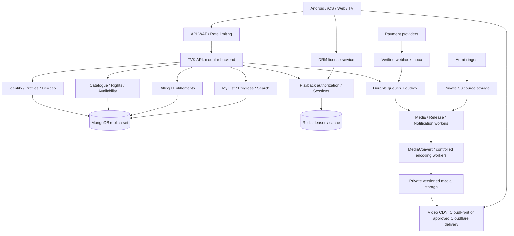

# TVK OTT — full OTT product and backend blueprint

Prepared 18 November 2026. This is a proposed architecture for TVK OTT, informed by public vendor documentation. It is not Netflix's private architecture. No Chirpi source, admin panel, or database was inspected for this proposal. Plan limits, timings, ladders, and performance objectives below are examples to validate, not contractual guarantees.

## 1. Product scope and three distinct decisions

TVK OTT should support long-form movies, episodic series, seasons, independent trailers/teasers, multilingual audio and subtitles, profiles, Kids controls, mobile/web/TV clients, adaptive streaming, subscriptions, concurrent-stream limits, DRM, downloads, search, recommendations, editorial management, analytics, and support operations.

Do not collapse these three decisions into one boolean:

1. **Discoverable:** May this profile see the title? Consider country/catalogue rights, release state, maturity, selected content language, and editorial rules.
2. **Playable:** May this account play this particular asset now? Add current subscription or rental entitlement, rights window, a ready media package, supported DRM/device, and a concurrent-stream reservation.
3. **Which capabilities:** Which quality, HDR mode, audio format, subtitles, downloads, and output protection are permitted?

A non-subscriber may see a discoverable movie with a Subscribe button. An unreleased movie can have a Coming Soon card and playable promotional trailer without a playable full movie. A title with no selected-language audio should not appear in TVK's strict audio-language catalogue merely because translated metadata exists.

## 2. User-facing modules

| Module | Required behavior |
|---|---|
| Identity | Phone/email authentication, real OTP delivery, abuse controls, account recovery, logout, revoked-device checks, suspension/deletion |
| Account and profiles | Billing at account level; independent profile history, My List, audio/subtitle preferences, maturity, PIN, autoplay preferences |
| Home | Editorial banners, Continue Watching, Trending, New Releases, genre and language rails, recommendations, Coming Soon |
| Movies | Localized detail page, cast/crew, artwork, runtime, certification, editions, languages, trailers, play/resume, related titles |
| Series | Series/season/episode hierarchy, language-specific availability, episode dates, next playable episode, release schedules |
| Player | ABR, selected audio/subtitles, permitted quality options, resume, skip intro/recap, next episode, supported casting, errors/retry |
| Search | Title/alias/cast/genre search, transliteration where supported, language/country/maturity filters, profile-aware history |
| Personal library | My List, watch history, Continue Watching, download management |
| Subscription | Plans, checkout, recurring renewals, upgrades/downgrades, cancellation, receipts, payment recovery, refunds/support |
| TV | QR/device-code sign-in, device approval, remote-friendly catalogue, profile/PIN, playback entitlements |
| Accessibility | Captions/SDH, audio description, accessible player controls and navigation |
| Operations | CMS, media ingest/QC, rights management, release scheduling, support, audit, operational dashboards |

Advanced expansion modules: advertising/SSAI, rentals/TVOD, extra-member/household products, live channels/events, sports DVR, games, advanced recommendation ML, multi-CDN failover. These are separate product/program scopes, not switches automatically provided by a VOD backend.

## 3. Reference backend architecture



There are two traffic paths:

- **Control plane:** login, catalogue, payment, playback authorization, progress. Small JSON requests through the API.
- **Media plane:** movie/episode segments, audio, subtitles, artwork delivered from object storage/CDN. They do not travel through the application server.

Start with a modular TypeScript backend, for example NestJS/Fastify, and independently deployed workers. Modules can share a deployment while retaining explicit boundaries. Extract services only for demonstrated scaling/team/availability needs. Keep encoders and long-running work outside HTTP/serverless request lifetimes.

Example deployment: two or more stateless API instances behind a load balancer; private managed MongoDB replica set; Redis; SQS or another durable queue; media workers; S3; MediaConvert; CloudFront; DRM provider; centralized secrets, logs, metrics, tracing, and CI/CD. A managed end-to-end video provider is an alternative if it proves the required TV/DRM/4K/offline capabilities.

## 4. Catalogue, movies, series, and media versions

Business hierarchy:

```text
Movie title -> Movie playable asset -> Edition -> Video/audio/text/package versions
Series title -> Season -> Episode playable asset -> Edition -> Track/package versions
Movie/Series/Season -> Trailer or teaser playable asset -> Its own tracks and rights
```

Example movie **Project V**:

- One title and localized names/descriptions/artwork.
- A theatrical edition and, optionally, a separate director's-cut edition.
- The theatrical edition has a common 120-minute picture master, Telugu original audio, English dub, and English/Telugu subtitles.
- If English uses the same picture/timeline, upload an additional synchronized audio master, not another complete picture encode.
- If Hindi is a different cut, duration, censor edit, or has different burned-in graphics, create a separate edition/picture master. Never attach its audio/subtitles to an incompatible timeline.

Example series **City Files**:

- Season 1, 8 episodes; Season 2, 6 episodes scheduled weekly.
- Each episode is independently uploaded, transcoded, quality-checked, rights-controlled, and published.
- Telugu may be ready for episodes 1–8 while English is ready only for 1–4.
- English users see only the eligible episodes. Episode counts and next-episode navigation are derived from English availability, not the series' overall episode total.
- Trailers are independent playable assets: a ready Telugu trailer does not prove the full Telugu movie/episode is ready.

Separate state machines:

```text
Catalogue: DRAFT -> IN_REVIEW -> APPROVED -> SCHEDULED -> PUBLISHED -> EXPIRED/UNPUBLISHED
Media: CREATED -> UPLOADING -> UPLOADED -> VALIDATING -> TRANSCODING
       -> PACKAGING -> QC -> READY | FAILED | QUARANTINED
```

An upload finishing does not publish content. A published title is playable only if its currently selected asset/edition/package and rights are ready.

## 5. Language architecture

Use stable BCP-47 language identifiers, such as `te`, `en`, `hi`, `ta`, `ml`, `kn`, `bn`, `de`, rather than English display names as database keys. Model four independent settings:

1. UI language.
2. Preferred content/audio language(s).
3. Subtitle language/off preference.
4. Localized metadata/artwork language.

Store these per profile, not solely on the account. A Kids profile can have different preferences from an adult profile.

TVK strict language mode can use this rule:

```text
episodeAvailable(profile, episode, language, country, now) =
  active published episode
  AND active parent season and series
  AND release/rights window permits country and language
  AND matching ready picture edition and ready audio track exist
  AND their packaged media passed QC
```

A series appears when at least one qualifying episode exists. A season appears when it contains qualifying episodes. Play authorization additionally checks subscription, concurrency, maturity/PIN, and device capability. A subscriber's plan should not silently alter audio-language eligibility unless a real rights/product rule requires that.

**Critical example:** a series lists Telugu, English, Hindi in metadata. Telugu and English media are ready; Hindi has only a tag. Telugu and English can qualify; Hindi cannot. English subtitles alone do not make English audio available. An uploaded Hindi audio file that failed QC also does not qualify.

Never fall back from a missing language variant to the first audio/video file without an explicit product/user decision. A separate clearly marked "Original audio with subtitles" catalogue mode is possible, but is not strict dubbed-language mode.

Availability is a derived, versioned read model updated by media-ready, rights, release, and takedown events. A reconciliation job repairs missed projections. Search, banners, Home, details, My List, progress, downloads, and playback consume the same policy. Authorization always rechecks authoritative current restrictions; search/cache projections can lag.

Upcoming content uses planned language metadata and its own state. It stays in Coming Soon, not playable rows. Play is disabled; an independently authorized trailer may remain available.

## 6. MongoDB design

Use a production replica set across failure domains, private access, TLS, application-scoped database credentials, backups, and tested restores. Do not expose a root database account in app configuration. MongoDB stores metadata and application state, not movie binaries or DRM secret keys.

| Collections | Main responsibility |
|---|---|
| `accounts`, `identities`, `otp_challenges` | Authentication, account status, challenge expiry/attempts |
| `profiles`, `devices`, `refresh_sessions`, `tv_device_codes` | Profile isolation, registered devices, rotated/revocable sessions, TV approval |
| `titles`, `title_localizations`, `people`, `credits`, `artworks` | Movies/series and localized editorial metadata |
| `seasons`, `episodes`, `playable_assets`, `editions` | Content hierarchy and alternate cuts/timelines |
| `source_assets`, `video_renditions`, `audio_tracks`, `text_tracks`, `packages` | Original files, encode outputs, ready tracks, manifests, version/QC state |
| `rights_windows`, `availability`, `publication_events` | Territory/platform/language/device/download rights and derived visibility |
| `banners`, `collections`, `collection_items` | Editorial Home rows and campaign schedules |
| `plans`, `plan_versions`, `subscriptions`, `entitlement_snapshots` | Product policy, versioned contracts, access periods |
| `orders`, `payments`, `refunds`, `invoices`, `ledger_entries`, `webhook_events` | Billing history, reconciliation, immutable financial events |
| `playback_sessions`, `download_licenses` | Durable session facts, offline grants and expiry |
| `watch_progress`, `watch_events`, `my_list`, `ratings` | Profile-specific engagement |
| `upload_sessions`, `transcode_jobs`, `qc_reports`, `outbox_events` | Asynchronous processing and recoverability |
| `notifications`, `support_cases`, `audit_logs` | Communications, support operations, admin audit |

Small example documents:

```json
{"_id":"movie_project_v","type":"movie","slug":"project-v","publicationState":"published","defaultLocale":"te"}
{"_id":"episode_s1e1","seriesId":"city_files","seasonId":"city_files_s1","episodeNumber":1,"playableAssetId":"asset_e1","publicationState":"published"}
{"_id":"edition_e1_v1","playableAssetId":"asset_e1","timelineVersion":1,"durationMs":2700000,"sourceAssetId":"master_e1"}
{"_id":"audio_e1_te","editionId":"edition_e1_v1","language":"te","role":"main","status":"ready","packageVersion":3}
{"_id":"audio_e1_hi","editionId":"edition_e1_v1","language":"hi","role":"main","status":"failed","packageVersion":3}
{"_id":"progress_1","profileId":"profile_1","playableAssetId":"asset_e1","editionId":"edition_e1_v1","positionMs":920000,"selectedAudioLanguage":"te","sequence":87}
```

Store server-generated identifiers/references as ObjectIds or another consistent identifier strategy; the readable IDs above are illustrative. Renditions contain object keys and technical metadata, not permanent public URLs. Money uses integer minor units plus currency, not binary floating-point. Dates are UTC, while release policies explicitly carry the editorial timezone where needed.

Important indexes/constraints:

- Unique provider identity; normalize email/phone before uniqueness checks.
- Unique `(seriesId, seasonNumber)` and `(seasonId, episodeNumber)`; specials use an explicit episode-type/order policy.
- Unique canonical title slug; localized aliases have explicit locale scope.
- Unique media track/version identity; versioned immutable object keys.
- Unique `(provider, providerAccount, eventId)` for webhook inbox.
- Unique `(provider, providerAccount, paymentId)` and a separate unique business entitlement/ledger operation key.
- Unique `(profileId, titleId)` for My List; `(profileId, playableAssetId, editionId)` for progress.
- Query indexes for availability by language/country/publication state, active rights windows, subscription account/state, and job retry schedule.
- TTL for expired challenges/device codes where appropriate. TTL deletion is asynchronous: every request still explicitly verifies `expiresAt`.

Use short multi-document transactions for payment state + ledger + entitlement + outbox records where atomicity is required. Never hold a DB transaction while calling a payment provider or encoder. Multi-document transactions require a supported replica-set/sharded topology; standalone MongoDB is unsuitable for this design.

Keep unbounded episode, event, progress, payment, and watch-history arrays out of account/title documents. Stream events to an analytics store such as ClickHouse/BigQuery/S3 instead of putting raw playback telemetry on the hot transactional database. Start without sharding; scale measured query/index patterns first.

## 7. Upload workflow and realistic speed

```text
Admin creates title/episode and edition
 -> API validates upload permission, quota, declared size/type
 -> creates multipart session and private object key
 -> issues short-lived signed URLs for selected parts
 -> browser uploads parts directly to S3
 -> client resumes/retries individual parts
 -> API verifies uploaded parts and completes the object
 -> worker probes checksum, media format, codecs, duration and source identity
 -> encoding job queued
```

Store upload ID, asset ID, owner, object key, expected size/checksum, part records, status, expiry, and job correlation. Validate actual server-side media rather than trusting the filename, Content-Type, ETag as a universal MD5, or the browser's "upload complete" flag. Scope signed URLs to specific keys/parts and set CORS deliberately.

Example initial tuning: 16–64 MiB chunks, 4–8 parallel requests with adaptive backoff. Tune for source size, S3 part limits, browser memory, measured network, and account limits. Do not upload full movies through a Node API, serverless function, or a generic CDN proxy. Abort abandoned multipart sessions with lifecycle rules. Duplicate completion requests and duplicate storage events must be idempotent.

Theoretical upload time: `file bytes × 8 / effective bits per second`.

| 10 GB decimal source | Ideal transfer time, before overhead |
|---|---|
| 20 Mbps upstream | ~66.7 minutes |
| 100 Mbps upstream | ~13.3 minutes |
| 1 Gbps upstream | ~80 seconds |

Multipart improves throughput/resume behavior; it cannot exceed the user's upstream bandwidth. Uploading, waiting for an encoder, encoding, QC, and publication are separate progress phases. Benchmark S3 Transfer Acceleration for geographically distant uploaders; it is not guaranteed faster and has additional charges.

## 8. Transcoding, packaging, and QC

Suggested pipeline:

1. Validate uploaded source, checksum, media decodability, duration/frame rate, track layout and rights.
2. Probe technical metadata; create deterministic encode job identity from source checksum + settings version + edition.
3. Encode an appropriate adaptive bitrate ladder.
4. Encode audio variants, preserve channel layout, validate loudness and sync.
5. Package HLS/DASH, potentially CMAF/fMP4; align video keyframes/segment boundaries across renditions.
6. Encrypt through the selected DRM integration.
7. Validate manifests, segment accessibility, codec/DRM compatibility, audio/video duration and sync, subtitles, frame samples, and audio silence/black-frame anomalies.
8. Publish a new package version atomically only after required outputs are ready.
9. Generate thumbnails, seek sprites, artwork derivatives, optional preview clips.
10. Update availability/search/cache through outbox events; retain rollback version.

Illustrative ladder, to tune per codec/content/device:

| Rendition | Example video bitrate range |
|---|---|
| 360p H.264 | 0.5–0.9 Mbps |
| 480p H.264 | 0.8–1.5 Mbps |
| 720p H.264 | 1.8–3.2 Mbps |
| 1080p H.264 | 3.5–6.5 Mbps |
| 2160p HEVC/AV1, supported devices | 12–25 Mbps, content-dependent |

These are planning ranges, not settings to apply universally. Never upscale a 1080p source to label it genuine 4K. Frame rate, motion, grain, HDR, and codec affect quality and bitrate. Evaluate per-title quality and representative low-end/TV devices. Start with H.264/AAC compatibility; add HEVC/AV1 and premium audio only with validated decoder/licensing support. Preserve HDR only through an HDR-capable source/encoder/package/player/display chain; provide SDR fallback. Dolby formats require compatible licensed tooling and delivery/device support.

For VOD, example 4–6 second segments are a starting point, not a universal requirement. Worker count and queues scale with paid encoder capacity and source throughput. Encoding time cannot be promised from movie duration alone. Retries use backoff, maximum attempts, dead-letter queues, cancellation, progress events, and cost/concurrency caps. A failed 4K job must not overwrite a healthy 1080p production package.

## 9. S3, CloudFront, Cloudflare R2, and Stream

**Option A — recommended reference for full premium OTT:** private S3 raw/source and output buckets + MediaConvert + multi-DRM provider + CloudFront. Use Origin Access Control to restrict S3 origin access. The API issues scoped playback authorization; CloudFront uses supported signed URLs/cookies. DRM licenses are separately authorized. Cloudflare can protect API/DNS/WAF traffic without automatically being the video CDN.

**Option B — Cloudflare media delivery:** preserve a source archive, encode/package in controlled workers or a compatible managed service, publish versioned outputs to private R2, serve through an authenticated Worker/custom-domain delivery route and approved Cloudflare cache design. Verify every request, including cache hits, without exposing the bucket. If MediaConvert processes in AWS and outputs are copied to R2, account for S3 transfer/egress, replication delay, copy validation, and operational complexity. R2's S3-compatible API does not make it an automatic drop-in MediaConvert output endpoint.

**Option C — Cloudflare Stream:** convenient managed ingest, encoding, playback, audio/captions and analytics. Its current public documentation describes H.264 adaptive output from 360p to 1080p, HDR-to-SDR conversion, and stereo downmix. This is not an assumed equivalent to a custom 4K/HDR/studio-DRM/offline stack. Verify commercial multi-DRM and offline requirements with the provider; signed playback tokens are not DRM.

R2 is object storage, not a transcoder or DRM license system. R2 has no internet-egress bandwidth fee under its published pricing, but storage, operations, Workers, transcoding, DRM and other components still cost money. AWS-to-R2 transfer is not made free by R2's egress policy. Do not assume ordinary Free/Pro Cloudflare proxying permits arbitrary OTT traffic; select an appropriate supported video product/delivery arrangement.

Versioned storage layout:

```text
raw/{assetId}/{sourceVersion}/master.mov
raw/{assetId}/{sourceVersion}/audio/te.wav
raw/{assetId}/{sourceVersion}/subtitles/en.srt
published/{assetId}/{editionId}/{packageVersion}/hls/master.m3u8
published/{assetId}/{editionId}/{packageVersion}/dash/manifest.mpd
published/{assetId}/{editionId}/{packageVersion}/video/1080p/...
published/{assetId}/{editionId}/{packageVersion}/audio/te/...
published/{assetId}/{editionId}/{packageVersion}/text/en/...
artwork/{titleId}/{artworkVersion}/...
```

Immutable media can be cached for long periods. Personalized entitlement responses cannot be shared-cache entries. Validate signed authorization before serving cached objects; ensure tokens do not destroy media cache reuse. Authorize all media resources, not just the top manifest. A token scoped to an entire package must not unintentionally grant premium-quality or disallowed-track paths. Direct origin access stays blocked.

## 10. Subtitle and audio upload

Admin chooses the exact edition/episode and uploads each caption track with language, role (normal subtitles, SDH/CC, forced), label, source format, encoding and optional controlled offset. Accept supported SRT/WebVTT/TTML/IMSC workflows. Validate UTF-8/text encoding, cue syntax, timestamps, end-after-start, track duration, unsafe markup, glyph rendering, reading speed, and edition alignment. Overlap may be valid for simultaneous speakers; distinguish errors from intentional overlap.

Processing converts/packages tracks into WebVTT/IMSC/TTML appropriate for the target HLS/DASH/device combination. Preserve originals, version outputs, review representative scenes, then attach ready tracks to the new manifest/package version. A subtitle-only correction usually needs text repackaging/manifest publication, not full video re-encoding. Never attach a theatrical subtitle track to a different cut without QC.

Subtitles are separate from dubbed audio and do not create audio-language availability. Burned-in text cannot be toggled off. Normal subtitles, forced subtitles and SDH are distinct roles; audio descriptions are an audio-track role. Save per-profile preferences and gracefully communicate unavailable tracks. Automatic transcription/translation is optional and needs human QC before premium publication.

## 11. Subscription products and enforcement

Netflix-style functionality means capabilities and lifecycle behavior; do not hard-code Netflix's current prices or claim TVK's sample plans are Netflix's plans.

Illustrative TVK plan matrix:

| Capability | Mobile | Standard | Premium |
|---|---|---|---|
| Permitted devices | Phone/tablet | Phone/tablet/web/TV | Phone/tablet/web/TV |
| Maximum video | 720p | 1080p | 2160p where ready/supported |
| Simultaneous streams per account | 1 | 2 | 4 |
| Registered-device allowance | 3 | 6 | 10 |
| Download-device allowance | 1 | 2 | 4 |
| Example profile allowance | 1 | 5 | 5 |
| HDR / premium surround | No | Optional policy | If entitled, supplied and supported |

Every number is a configurable TVK proposal. Registration, concurrent playback, downloads, profiles, casting, and household membership are independent policies. Four profiles do not create four streams. A phone-only account cannot obtain a TV license just by spoofing a user-agent; use platform identity, supported attestation/DRM signals and registered-device policy, recognizing that client classification alone is not absolute proof.

Store immutable plan versions and a purchased policy snapshot. An admin editing a plan must not silently rewrite existing customers' contracts. Effective capabilities are an intersection of plan, asset-ready renditions, rights, device/codec/DRM/display restrictions, and current network ABR choice. Quality controls must be enforced in playback manifests/resource authorization and, where supported, DRM license/key policy—not only hidden UI options.

Example lifecycle:

```text
PENDING -> ACTIVE -> PAST_DUE -> ACTIVE or EXPIRED
ACTIVE -> cancelAtPeriodEnd=true -> EXPIRED at paid-through date
ACTIVE -> immediate termination/refund, only under explicit policy
```

Define start/end timestamps, renewal anchor, timezone display, grace rules, cancellation, refunds/chargebacks, upgrade proration, downgrade effective date, promo eligibility, taxes/currency, and restore-purchase behavior. Use provider-specific adapters for web payments and mobile app-store purchases. App-store receipt/server-notification validation is separate from web checkout. Distribution rules vary by store/region and need a release-time review.

Payment flow: create server-side order -> provider checkout -> verify signature/provider status -> durably accept event -> atomically update payment/ledger/entitlement/outbox -> notify. Never grant premium from a frontend success screen alone. Deduplicate provider events and separate business actions; out-of-order events must not revert newer valid state. Reconcile unknown/pending transactions and provider subscription state on schedules. Do not double-renew when duplicate callbacks arrive.

## 12. Playback authorization and concurrent screens

`POST /v1/playback/sessions` takes asset/edition, profile, registered device, requested language and capabilities. The backend:

1. Authenticates the account/device and checks suspension, token revocation and profile ownership.
2. Resolves requested episode/movie and parent relationships.
3. Applies region, rights window, publication, maturity/PIN and language rules.
4. Confirms a ready compatible edition/audio/package.
5. Resolves paid/free/trailer entitlement and permitted capabilities.
6. Atomically reserves an account-wide concurrent-playback lease.
7. Returns short-lived media authorization, package/manifest reference, DRM license information, permitted tracks/qualities, markers, resume position and heartbeat policy.

Use a bounded lease, for example heartbeat every 30 seconds and expiry after 90 seconds, tuned to your desired UX. Reservation must be atomic; two simultaneous play requests cannot both claim the last screen. Repeated retries for one session are idempotent. Seek, rendition changes, and a normal track switch do not allocate extra screens. Casting has an explicit sender/receiver session-transfer rule. Previews/trailers need a separately specified screen-count policy.

On app crash, leases expire. Remote logout, entitlement expiry and rights changes block subsequent authorization/renewal; cached segments and outstanding DRM licenses mean revocation is bounded, not magically instantaneous. A Redis restart must not reset limits while old authorized streams continue: recover/reconcile durable session facts or temporarily refuse new leases. Do not call MongoDB once per media segment.

Example response:

```json
{
  "sessionId": "play_123",
  "assetId": "asset_e1",
  "editionId": "edition_e1_v1",
  "selectedAudioLanguage": "te",
  "permittedResolutions": [360, 480, 720, 1080],
  "manifestUrl": "https://media.tvk.example/scoped-manifest.m3u8",
  "expiresInSeconds": 300,
  "heartbeatIntervalSeconds": 30,
  "drm": { "system": "widevine", "licenseUrl": "https://license.tvk.example/widevine" }
}
```

The URLs/values above are illustrative. Device and entitlement decisions are server-side, not trusted claims from this response's requesting client.

## 13. DRM, TV sign-in, downloads, and security

Use a commercial multi-DRM integration that supports Widevine, FairPlay and PlayReady across the intended platform matrix. DRM format/encryption/device compatibility requires real-device certification tests. MediaConvert SPEKE integrates with compatible key providers; it is not itself an end-user license server. For premium quality isolation, use verified resource authorization and DRM key/license policies; if all qualities share an unrestricted key and accessible paths, hiding the 4K manifest entry is insufficient.

Store DRM key references, not raw keys in MongoDB or frontend responses. Signed URLs limit delivery access but do not replace DRM. Hardware security/HDCP/output restrictions must match rights requirements. Watermarking can deter/trace leaks; neither DRM nor an overlay guarantees that external-camera recording is impossible.

TV sign-in: show a short-lived user code/QR; phone opens the official TVK approval page; authenticated user sees device details and explicitly approves; TV polls with a separate secret device code at a rate-limited interval. User code is single-use, expires, and cannot be substituted for the secret polling credential. Follow OAuth device-authorization principles rather than placing a long-lived account token in a QR URL.

Downloads use encrypted segments plus a supported device-bound persistent DRM license. Record device, profile visibility, asset/edition/package, selected audio/text, quality, issuance/expiry/renewal, rights, and license status. Offline restrictions are limited by previously issued license duration; a server cannot instantly revoke an offline device it cannot contact. DRM/device capability and content download rights can limit offline support, particularly on TV/web. Do not promise downloads on every platform or deliver a permanent public MP4 for premium offline use.

Security baseline: secrets manager, TLS, private DB, least-privilege IAM, admin MFA/RBAC, audited publishing, OTP hashing/attempt limits/atomic cooldown/abuse controls, refresh rotation and reuse detection, profile ownership checks, webhook verification, upload scope/size/quota checks, SSRF-safe remote imports, encryption at rest, rate limits, log redaction, dependency review, and tested incident response. Legal/privacy/content-rights obligations require appropriate local review; this blueprint is technical, not a jurisdiction-specific compliance opinion.

## 14. User state and recommendations

- My List is a per-profile relation to the title; changing language hides incompatible titles without deleting saved relations.
- Continue Watching keys progress by profile, playable asset and edition. Store selected tracks, position, duration, completion and server-ordered sequence/timestamps.
- Accept legitimate backwards seeks; reject stale out-of-order updates instead of always taking the maximum position. Clamp impossible positions. A new edit may require explicit progress migration.
- Choose the next published eligible episode in the selected language/season order, skipping unavailable/draft episodes. Define whether to skip gaps or stop with an availability explanation.
- Keep playback capability separate from recommendations; recommendations can never bypass rights or maturity filters.
- Begin recommendation ranking with editorial, genre, language and viewing signals. Add ML only after clean event collection/evaluation.

## 15. API contracts and operational behavior

Example groups:

```text
POST /v1/auth/otp/challenges
POST /v1/auth/otp/verify
POST /v1/auth/refresh
POST /v1/tv/device-authorizations
POST /v1/tv/device-authorizations/approve
GET  /v1/profiles/{profileId}/home
GET  /v1/catalog/movies
GET  /v1/catalog/series
GET  /v1/titles/{titleId}
GET  /v1/series/{seriesId}/seasons
GET  /v1/seasons/{seasonId}/episodes
GET  /v1/search
POST /v1/playback/sessions
POST /v1/playback/sessions/{id}/heartbeat
DELETE /v1/playback/sessions/{id}
PUT  /v1/profiles/{profileId}/progress/{assetId}
POST /v1/download-licenses
GET  /v1/plans
POST /v1/billing/orders
POST /v1/webhooks/{provider}
POST /v1/admin/uploads
POST /v1/admin/uploads/{id}/complete
POST /v1/admin/titles/{id}/publish
```

All profile IDs require account ownership validation. Use cursor pagination, consistent error envelopes and stable IDs. Example business error codes: `LANGUAGE_UNAVAILABLE`, `REGION_RESTRICTED`, `CONTENT_NOT_READY`, `SUBSCRIPTION_REQUIRED`, `SCREEN_LIMIT_REACHED`, `DEVICE_NOT_ALLOWED`, `QUALITY_NOT_ENTITLED`, `AUTH_SERVICE_UNAVAILABLE`. Do not expose internal DB errors. Recoverability/retry hints are explicit; the client must not blindly retry a payment mutation or OTP send loop.

Use a transactional outbox/durable inbox for media, payment and catalogue changes. Queues are at-least-once; consumers must be idempotent. Prefer state versions over timestamp-only comparisons for out-of-order jobs. Build an admin retry/reconcile screen.

## 16. Speed, monitoring, capacity and cost

Example initial objectives, to validate by country/device/network and load test:

- Cached catalogue API p95 <300 ms; uncached metadata p95 <700 ms.
- Playback authorization p95 <500 ms excluding external DRM/player startup.
- Playback start p95 <3 seconds on a defined healthy-network/device test cohort.
- Login external-provider latency separately measured; OTP SMS delivery is not an API-only latency metric.
- Measure API availability, playback-start success, rebuffer ratio, startup, bitrate, dropped frames, license errors and fatal errors by device/ISP/region/app version.

Use precomputed catalogue availability, indexed queries/projections, connection pooling, distributed caches, bounded timeouts, circuit breakers and bulkheads. Use cache keys that include applicable language/territory/maturity/catalogue version; profile-specific rows must not leak across profiles. Never cache a subscription allow decision beyond its legitimate validity. Do not perform catalogue maintenance, payments, transcoding or analytics aggregation inside login requests.

MongoDB failure should not turn into fake successful login or unrestricted free playback. CDN playback of already authorized content may continue within existing credential/license validity; new paid authorization remains safely bounded. Queue backlogs, expired jobs, payment reconciliation, missing media, CDN cache hit rates, DB pool saturation and cost anomalies need alerts.

Capacity examples:

- 10,000 simultaneous viewers at average 5 Mbps require about 50 Gbps of video delivery.
- One viewer-hour at 5 Mbps is about 2.25 GB of video, before audio/protocol overhead.
- 10,000 viewers each watching two hours at that bitrate is about 45 TB.

Budget separately for original/archive storage, encoded renditions/audio/subtitles, encoder minutes, CDN/egress, storage requests, DRM licenses, API/DB/cache/search, SMS, payment fees, analytics, observability, support, and multi-region redundancy. Audience concurrency and hours watched are more useful than total registered users for initial video-capacity estimates.

Backups are not proven until restoration is tested. Set explicit RPO/RTO, restore payment/account state carefully, reconcile providers, and handle media-version references. Keep dev/staging/prod credentials, buckets, provider webhooks and databases separate.

## 17. Acceptance and failure test matrix

These are scenarios to automate and run; no claim is made that TVK implementations already pass them.

| ID | Scenario | Required result |
|---|---|---|
| A01 | New user, correct OTP | Account/session created once; valid token |
| A02 | Existing user, correct OTP | Existing profile/subscription retained |
| A03 | Wrong OTP | Rejected; atomic attempt increment |
| A04 | Five concurrent wrong attempts | Limit enforced without lost increments |
| A05 | OTP expired but TTL record exists | Rejected by expiry check |
| A06 | OTP verification replay | At most one successful challenge consumption |
| A07 | Concurrent OTP sends | Atomic cooldown/abuse limits |
| A08 | SMS provider timeout | Truthful retryable result; no false delivery claim |
| A09 | MongoDB outage | Bounded 503; no access granted |
| A10 | Suspended/deleted account | Login and token renewal denied |
| A11 | Refresh-token reuse | Compromised refresh family revoked under policy |
| A12 | Profile ID belongs to another account | Access denied |
| A13 | TV user code expires/replays | Approval denied |
| A14 | Attacker changes TV device-code binding | Approval/session denied |
| L01 | Hindi tag exists, no Hindi media | Hidden from strict Hindi catalogue |
| L02 | Hindi subtitles only | Not treated as Hindi audio |
| L03 | Audio variant exists, source missing | Not playable/eligible |
| L04 | Audio uploaded, encode/QC failed | Not playable/eligible |
| L05 | English ready for only episodes 1–4 | English season/details/counts show 1–4 |
| L06 | One eligible episode in season | Season visible with truthful count |
| L07 | Parent season inactive | Its episodes do not qualify series |
| L08 | Episode linked to another season/series | Relationship rejected |
| L09 | Draft/Scheduled/Inactive episode | Excluded until legitimately published |
| L10 | Change Telugu to English | All surfaces refresh; saved items retained |
| L11 | Selected language has zero titles | Empty state; no unrelated fallback |
| L12 | Different profiles choose different languages | Isolated catalogue/history/My List |
| L13 | Cached Telugu result requested by English profile | No cross-language cache leak |
| L14 | Metadata localization changes | Does not invent an audio track |
| L15 | Movie has incompatible alternate cut | Audio/text attached only to matching edition |
| L16 | Language/rights removed after search indexed | Playback denied; projections invalidated |
| C01 | Ready movie and active rights | Discoverable and playable for entitled user |
| C02 | Ready title, no subscription | Discoverable with paywall if product policy permits |
| C03 | Future release | No premature full-content playback |
| C04 | Coming Soon with ready trailer | Trailer policy allowed; main movie blocked |
| C05 | Rights expire during a session | Renewal/license decisions follow bounded expiry policy |
| C06 | Country/platform rights differ | Correct restrictions per request |
| C07 | Kids profile requests mature title by direct ID | Server blocks, not just UI |
| C08 | Banner links to deleted/unready asset | Not presented as playable |
| C09 | New package becomes ready | Atomic version switch; previous package survives rollback |
| C10 | Episode reordered or special added | Stable identity/progress; correct explicit ordering |
| U01 | 20 GB upload interrupted at 70% | Resume uploaded parts; no complete restart |
| U02 | Signed part URL expires | Safe renewal for same authorized upload |
| U03 | Unauthorized uploader guesses asset/upload ID | No sign/complete/read access |
| U04 | Declared size/checksum differs | Quarantine/reject before encode/publication |
| U05 | Duplicate complete request/storage event | One logical media job |
| U06 | Abandoned multipart upload | Lifecycle cleanup, no endless orphan cost |
| U07 | Source extension disguises unsupported media | Probe rejects; no unsafe processing |
| U08 | Encoder worker dies mid-job | Retry/resume policy; no fake READY |
| U09 | Replayed old encode success after new source | Old version cannot overwrite new version |
| U10 | Failed 4K output, valid 1080p output | Publish only according to required-output policy |
| U11 | 1080p master requested as 4K | No artificial genuine-4K capability claim |
| U12 | Dub audio duration/sync mismatch | QC fails or approved corrected offset, not silent corruption |
| U13 | Batch uploads exceed provider quota | Queue/backpressure, retriable status |
| U14 | New subtitle added after publication | Versioned text/package update without unnecessary video encode |
| S01 | SRT malformed/out-of-range cue | QC rejection with actionable report |
| S02 | Telugu/Tamil/German glyphs | Correct rendering across device matrix |
| S03 | Forced vs SDH vs normal subtitles | Independent labels/default selection |
| S04 | Subtitle from different cut | Rejected/mapped through explicit edition QC |
| S05 | Player seeks/audio switches | Caption sync retained |
| S06 | Subtitle preference unavailable | Clear behavior; no wrong-language track presented as requested |
| P01 | Checkout UI success, payment unconfirmed | No premature premium access |
| P02 | Forged webhook | Signature rejected |
| P03 | Same valid webhook delivered 10 times | One business/ledger effect |
| P04 | Different events reference same payment | No duplicate entitlement grant |
| P05 | Out-of-order paid/failed/cancel events | State does not regress incorrectly |
| P06 | Provider succeeds, response is lost | Reconcile recovers payment; no duplicate charge intent |
| P07 | Renewal fails | Grace/past-due rules applied once |
| P08 | Cancel at period end | Access continues until paid-through date |
| P09 | Upgrade/downgrade | Correct effective time, invoice and capability change |
| P10 | Refund/chargeback | Financial reversal and entitlement policy consistent |
| P11 | Invalid app-store receipt or replay | No entitlement grant |
| P12 | Store purchase restored | Correct account/provider mapping; no double subscription |
| P13 | Old plan changed by admin | Existing purchased contract follows version policy |
| P14 | Currency or amount tampered | Server-side order rejects mismatch |
| D01 | Plan allows 2 streams; 3rd starts | Third rejected or explicit eviction flow |
| D02 | Two requests race for final screen | Only one new lease succeeds |
| D03 | Retry same playback-session creation | Same lease, not duplicate quota usage |
| D04 | App crashes, no release request | Lease expires under bounded timeout |
| D05 | Seek/ABR/audio switch | No additional screen consumed |
| D06 | Phone-only plan requests TV playback | Denied based on trusted policy/device signals |
| D07 | User requests hidden 4K segment directly | Path/license authorization blocks it |
| D08 | Weak DRM/output protection on 4K title | Reduce capability or deny per rights |
| D09 | Cast transfers playback | Correct sender/receiver screen accounting |
| D10 | Redis lease store restarts | No quota reset permitting uncontrolled concurrency |
| D11 | Remote logout during playback | New authorization denied within documented revocation bounds |
| D12 | Profile switch on same account | Profile isolation; screen quota remains account-wide |
| O01 | Download-device quota exceeded | Clear refusal/device-management action |
| O02 | Offline license expires | Playback blocked/renewal requested according to DRM policy |
| O03 | Download files copied to another device | No valid device-bound license |
| O04 | Language changes after download | Visibility follows policy; files not silently deleted |
| O05 | Content rights expire while device offline | Existing bounded offline-license policy applies |
| O06 | App reinstalled/new device | Reauthorization/redownload policy; no portable raw key |
| R01 | Older progress arrives after newer progress | Stale event ignored |
| R02 | User intentionally seeks backwards | Accepted as new progress, not max-position-only |
| R03 | Next episode lacks selected language | No silent other-language autoplay |
| R04 | Saved title becomes temporarily unavailable | Hidden/unavailable state, relation preserved |
| R05 | Profile A watches title | Profile B progress/recommendations unchanged |
| F01 | Origin/storage unavailable | Bounded failures; existing cache behavior measured |
| F02 | DRM service unavailable | Clear failure; no unencrypted fallback |
| F03 | Public URL guesses private source/output key | Origin access denied |
| F04 | Expired/tampered CDN token on cache hit | Denied before media serving |
| F05 | Release scheduler event lost | Reconciliation repairs availability |
| F06 | Payment/media queue backlog | Alerts/backpressure; no HTTP request hanging on work |
| F07 | Peak premiere traffic | Load-test catalogue/auth/license/CDN separately |
| F08 | Backup restored to staging | Integrity checked; no accidental real billing/SMS |
| F09 | New deployment breaks playback contract | Compatibility/rollback tests retain active sessions |
| F10 | Logs capture headers or OTP/payment fields | Redaction test fails build/release |

Cross these tests with Android/iOS, Chrome/Safari/Firefox/Edge as supported, Android/Google TV, Fire TV, tvOS and selected Samsung Tizen/LG webOS models. Platform-specific codec/DRM/remote/casting/offline behavior needs physical devices. "Works on Android phone" does not prove Smart TV support.

## 18. Implementation and release sequence

1. **Product contracts:** launch countries, platforms, languages, strict vs inclusive discovery, rights, editions, billing/plan policy, device matrix, premium formats, downloads, and traffic assumptions.
2. **Foundation:** infrastructure as code, secrets, CI/CD, identity, account/profiles, MongoDB replica set, observability, catalogue/rights, API contracts.
3. **Media MVP:** source ingest, multipart/resume, encoding/QC, HLS/DASH, private CDN, DRM, movies/series/trailers and subtitle/audio workflows.
4. **Commercial playback:** verified payments, plan versions, entitlements, atomic screen leases, TV sign-in, profile-aware progress/library, support tools.
5. **Launch hardening:** target-device certification, abuse/security testing, load/chaos tests, restore exercises, rights/takedown drills, billing reconciliation, QoE dashboards and cost alarms.
6. **Expansion:** supported offline downloads, 4K/HDR/surround device tiers, richer localization, personalized ranking, household rules, ads/live as separately approved modules.

Do not call a release "complete OTT" solely because CRUD, MP4 playback and a premium flag work. Launch acceptance needs the catalogue/media/rights/entitlement/session rules to agree across every client surface.

## Primary references

- Netflix public experience: https://help.netflix.com/en/node/102377
- Netflix public plan concepts: https://help.netflix.com/en/node/24926
- S3 multipart: https://docs.aws.amazon.com/AmazonS3/latest/userguide/mpuoverview.html
- S3 Transfer Acceleration: https://docs.aws.amazon.com/AmazonS3/latest/userguide/transfer-acceleration.html
- MediaConvert sidecar captions: https://docs.aws.amazon.com/mediaconvert/latest/ug/sidecar-captions-support-tables-by-container-type.html
- MediaConvert SPEKE/DRM matrix: https://docs.aws.amazon.com/mediaconvert/latest/ug/encryption-choosing-speke-version.html
- CloudFront private S3 origin: https://docs.aws.amazon.com/AmazonCloudFront/latest/DeveloperGuide/private-content-restricting-access-to-s3.html
- CloudFront signed delivery: https://docs.aws.amazon.com/AmazonCloudFront/latest/DeveloperGuide/private-content-signed-urls.html
- Cloudflare Stream capabilities: https://developers.cloudflare.com/stream/
- Cloudflare Stream HDR/audio/source limits: https://developers.cloudflare.com/stream/faq/
- Cloudflare additional audio: https://developers.cloudflare.com/stream/edit-videos/adding-additional-audio-tracks/
- Cloudflare video delivery policy: https://developers.cloudflare.com/fundamentals/reference/policies-compliances/delivering-videos-with-cloudflare/
- R2 cost components: https://developers.cloudflare.com/r2/pricing/
- MongoDB transaction topology: https://www.mongodb.com/docs/manual/core/transactions-production-consideration/
- MongoDB unique indexes: https://www.mongodb.com/docs/manual/tutorial/unique-indexes-schema-validation/
- Razorpay webhook verification: https://razorpay.com/docs/webhooks/validate-test
- OAuth TV/device authorization: https://www.rfc-editor.org/rfc/rfc8628
- FairPlay Streaming: https://developer.apple.com/streaming/fps/
- Apple offline HLS/keys: https://developer.apple.com/videos/play/wwdc2020/10655/
